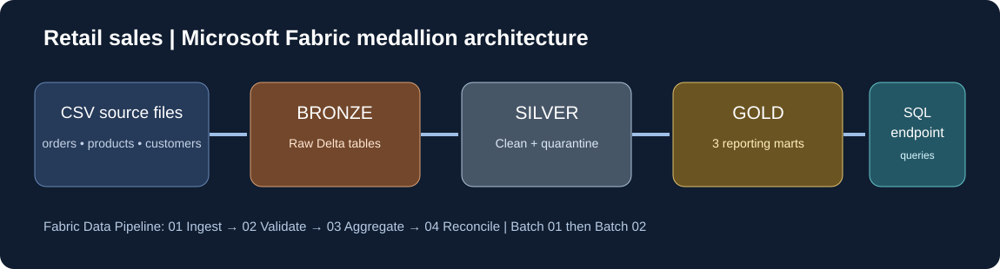

# Retail Sales Lakehouse | Microsoft Fabric Medallion Pipeline

*A small retail dataset, a late-arriving order correction, and a design that makes data quality visible rather than quietly dropping bad records.*



## The business question

Imagine a retailer receiving daily order exports from its storefront. A sales manager wants reliable answers: **How much did we sell each day? Which products bring in revenue? Which customers buy repeatedly?** The raw CSV exports aren't ready for those questions. They contain string fields, cancellations, returns, a handful of invalid orders, and even a later correction to an order that was already received.

This portfolio project shows how I would organize that workflow in **Microsoft Fabric**: land source records in Bronze, validate and deduplicate into Silver, publish three Gold marts, and orchestrate the notebooks using a Fabric Data Pipeline.

## What the project includes

| Layer | Fabric objects | Why it exists |
|---|---|---|
| Source | 4 CSVs in `Files/source/` | Repeatable input for a demo; 150 customers, 30 products, 2 order deliveries |
| Bronze | `bronze_orders`, `bronze_customers`, `bronze_products` | Preserve original strings, file names, ingestion timestamps |
| Silver | `silver_orders`, `silver_customers`, `silver_products`, `silver_orders_quarantine` | Typed data, latest-version deduplication, reference checks, rejected-record investigation |
| Gold | `gold_daily_sales`, `gold_product_performance`, `gold_customer_value` | Business-ready reporting tables |
| Orchestration | 4 notebook activities in a Fabric pipeline | Ordered runs, monitoring, optional scheduling |

## Data flow and important design choices

**Bronze: keep the evidence.** The first ingest contains **1,604** order rows, including four intentionally invalid records. Batch 2 contains **402** rows: 400 new orders, one correction to an existing order, and one invalid quantity. The loader skips a batch if its source filename has already been loaded, so a same-batch rerun does not duplicate Bronze rows.

**Silver: make quality inspectable.** Numeric and date strings are cast to proper types; customer and product identifiers must exist; quantity and unit price must be positive; and status must be Completed, Returned, or Cancelled. The latest `updated_at` wins when an `order_id` appears more than once. Invalid orders go into a dedicated quarantine Delta table with a reason.

**Gold: define revenue deliberately.** Only `Completed` orders contribute to sales revenue. Returned and Cancelled orders are still preserved in Silver for other analyses. Gold marts summarize daily sales, product performance, and customer lifetime revenue.

**Tradeoff:** ingestion is incremental, but Silver and Gold are rebuilt from Bronze each run. That is a conscious simplification for a small, understandable portfolio example. For larger volumes I would use change tracking/MERGE and partition-aware processing. Bronze's filename-level idempotency is suitable for immutable demo files, **not** for replacing a file under the same name.

## Running it in Fabric

1. Create a workspace with Fabric capacity/trial and a Lakehouse named `lh_retail_medallion` (use the standard non-schema Lakehouse option if presented).
2. Upload all four files from [`data/`](data/) to Lakehouse **Files → source**.
3. Import the four notebooks from [`notebooks/`](notebooks/). Attach `lh_retail_medallion` as the **default lakehouse** for each notebook. Use a PySpark/Spark notebook, not a Python-only notebook.
4. Run `01_bronze_ingestion` with `batch_id = "01"`, followed by `02_silver_quality`, `03_gold_marts`, then `04_validation`.
5. Create `pl_retail_medallion` with **four Notebook activities**, connected **on success** in that same order. Run with `batch_id = "02"` on notebook 01 (set it as a pipeline parameter or set the notebook parameter value). Run the other notebooks normally.
6. Open the Lakehouse SQL analytics endpoint and execute [`sql/reporting_queries.sql`](sql/reporting_queries.sql). Capture evidence using [`assets/SCREENSHOTS.md`](assets/SCREENSHOTS.md).

**Full click-by-click instructions:** see the separate `Fabric_Replication_Guide.docx` delivered alongside this repository. Fabric Runtime 2.0 (Spark 4.1 / Python 3.13) is the current default GA runtime; no external libraries are needed.

## Expected validation milestones

| After run | Bronze rows | Distinct order IDs | Expected quarantine | Explanation |
|---|---:|---:|---:|---|
| Batch 01 | 1,604 | 1,604 | 4 | Four deliberately malformed records |
| Batch 02 | 2,006 | 2,005 | 5 | One corrected order ID and one more bad row |

The actual valid-order and Gold revenue counts are calculated by the Fabric notebooks. Record the observed results after execution rather than claiming a run that has not happened.

## Evidence from the live Fabric run

**Current status:** runnable project supplied; **Fabric execution and screenshots pending**. The image above is a vector architecture diagram, not a Fabric UI capture. After completing the run, replace this status with your run date, results, and the real screenshots listed in [`assets/SCREENSHOTS.md`](assets/SCREENSHOTS.md).

- [Workspace + lakehouse view](assets/SCREENSHOTS.md)
- [Bronze, quality, and Gold evidence checklist](assets/SCREENSHOTS.md)
- [Pipeline execution and SQL results checklist](assets/SCREENSHOTS.md)

## Repository map

```text
fabric-retail-lakehouse/
├── README.md             # Business story, decisions and run instructions
├── data/                 # Synthetic CSVs, including an incremental second batch
├── notebooks/            # Four importable Fabric PySpark notebooks
├── sql/                  # Business reporting queries
├── assets/               # Architecture illustration and real screenshot checklist
└── tests/                # Local input-data sanity check
```

## Local input check

```bash
python tests/local_data_checks.py
```

This local script validates the synthetic source files; **it does not replace the Fabric execution tests** in notebook 04.

## Limitations and next iteration

This is a synthetic, single-lakehouse, batch-processing demonstration—not a production streaming implementation. It deliberately omits secrets, managed deployment automation, a live business source, and Power BI artifacts. A natural next step would be a full CDC ingestion design, audit/run tables, failure notifications, and a Power BI semantic model built from the Gold layer.

## References

- [Microsoft: Fabric Runtime 2.0](https://learn.microsoft.com/en-us/fabric/data-engineering/runtime-2-0)
- [Microsoft: Load data into a lakehouse with a notebook](https://learn.microsoft.com/en-us/fabric/data-engineering/lakehouse-notebook-load-data)
- [Microsoft: Notebook activity for Fabric pipelines](https://learn.microsoft.com/en-us/fabric/data-factory/notebook-activity)
