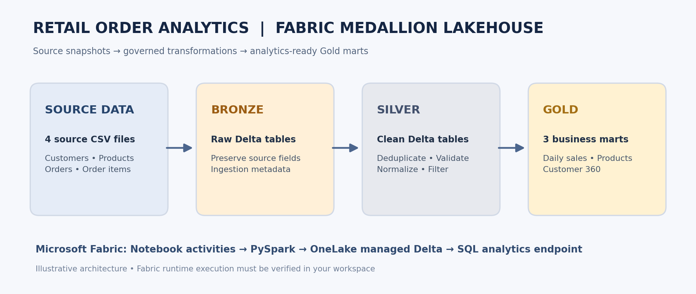
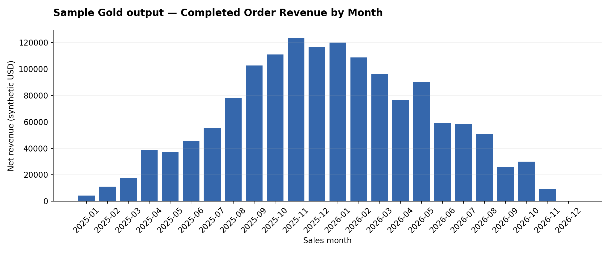
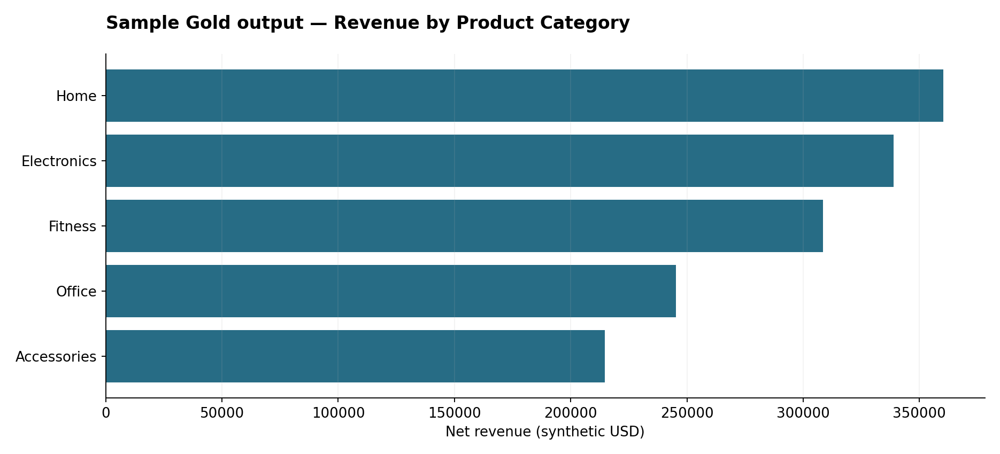

# Retail Sales Analytics with Microsoft Fabric | Medallion Lakehouse

**A data engineering portfolio project turning raw retail orders into validated, analytics-ready sales tables.**  
**Stack:** Microsoft Fabric · PySpark · Delta Lake · OneLake · SQL · Python · Data Quality



> **What is demonstrated:** Working synthetic retail data, a locally verified reference implementation, four Fabric-compatible notebooks, quality checks, sample outputs, and a reproducible deployment guide. **Fabric execution is not yet verified**; the screenshots and result charts currently come from the local Python reference pipeline. The Fabric Data Factory pipeline is documented for creation, not included as a deployed pipeline.

## The business problem

A fictional retailer has customer, product, order and order-item CSV files. Reporting directly on these raw files risks duplicate records, invalid product references, inconsistent customer attributes, and cancelled orders being counted as revenue. This project organizes the data into Bronze (raw), Silver (validated), and Gold (business-ready) layers.

## What the pipeline delivers

| Stage | What happens | Recruiter takeaway |
|---|---|---|
| **Bronze — ingest** | Load 4 source files and preserve raw fields | Traceable ingestion |
| **Silver — clean** | Deduplicate IDs, validate quantities and relationships, standardize missing regions | Data quality and reliable joins |
| **Gold — analyze** | Produce daily sales, product performance, customer 360 | Usable analytics tables |
| **Quality checks** | Reconcile revenue and validate expected table constraints | Trustworthy results |

### Results from a reproducible local sample run

| Metric | Value |
|---|---:|
| Fictional source orders | **1,800** |
| Gold datasets | **3** |
| Planned Fabric Delta tables | **11** |
| Net revenue from completed orders (synthetic sample) | **$1,467,636.93** |
| Automated local tests | **6 passing** |





All metrics and charts represent **synthetic data**, not a real retailer. They have been calculated using the local reference pipeline, not a published Fabric deployment.

## Explore this repository in 60 seconds

| Open this | What you will find |
|---|---|
| **[1-Fabric-Notebooks](1-Fabric-Notebooks/)** | The four numbered PySpark notebooks: ingest → clean → Gold tables → checks |
| **[2-Sample-Retail-Data](2-Sample-Retail-Data/)** | Four understandable, fictional CSV source files |
| **[3-Project-Results](3-Project-Results/)** | Architecture, charts, and example Gold output tables |
| **[4-Setup-and-Testing](4-Setup-and-Testing/)** | How to reproduce it, local Python, SQL, configuration and tests |

**Start with the two charts above**, then open the Gold CSV outputs under [sample-gold-tables](3-Project-Results/sample-gold-tables/). After that, read the [Fabric notebooks](1-Fabric-Notebooks/) if you want to inspect the engineering implementation.

## Run the local version

Python 3.10+ required. From the repository root:

```bash
python -m pip install -r 4-Setup-and-Testing/requirements-local.txt
python 4-Setup-and-Testing/local_python/run_local_demo.py --source 2-Sample-Retail-Data --output 3-Project-Results/local-run
python -m pytest 4-Setup-and-Testing/automated_tests -q
```

The local pipeline generates reproducible CSV tables and a quality report. It deliberately does **not** claim to write Fabric Delta tables.

## Run the notebooks in Microsoft Fabric

1. Create a Fabric workspace and Lakehouse with Spark support.
2. Upload the four CSVs from `2-Sample-Retail-Data/` to the Lakehouse path `Files/source/ecommerce/`.
3. Import and attach the four numbered notebooks from `1-Fabric-Notebooks/`.
4. Execute them in order and inspect the Bronze, Silver and Gold Delta tables.
5. Configure Notebook activities with success dependencies using the [pipeline guide](4-Setup-and-Testing/guides/PIPELINE_SETUP.md).
6. Run the [sample SQL queries](4-Setup-and-Testing/business_sql/gold_business_queries.sql) and capture genuine Fabric screenshots.

Full instructions: **[Fabric deployment guide](4-Setup-and-Testing/guides/FABRIC_SETUP.md)**. For assumptions and data definitions, see the [data dictionary](4-Setup-and-Testing/guides/DATA_DICTIONARY.md).

## Important engineering choices

- **Idempotent full refresh**, rather than incorrectly claiming incremental ingestion or CDC.
- Only **Completed** orders contribute to realized Gold revenue.
- Intentionally invalid rows are excluded from valid Silver items; a production pipeline should preserve them in a quarantine table.
- Local Pandas tests and Fabric PySpark code are separate implementations; local success cannot establish a Fabric runtime result.
- The activity configuration is a **design specification**, not a ready-to-import Fabric Data Factory pipeline export.

## Honest resume description

**Retail Sales Analytics — Microsoft Fabric Medallion Lakehouse (Portfolio Project)**  
*PySpark · Delta Lake · Fabric Lakehouse · Data Validation · SQL*

- Developed a reproducible retail medallion architecture with four PySpark notebooks covering Bronze ingestion, Silver cleansing, Gold business marts, and data-quality checks.
- Transformed four fictional retail datasets into three analytics-ready Gold datasets with revenue reconciliation, referential checks, and automated local validation.
- Documented Fabric Lakehouse deployment and Notebook activity orchestration for runtime verification in a Fabric workspace.

**After successfully executing the solution in Fabric**, replace the last point with a truthful statement of the actual orchestration you deployed and include screenshots in `3-Project-Results/visuals/screenshots/`.

---

**Note for recruiters:** This is a self-directed portfolio demonstration with synthetic data. It is not represented as a production client engagement. [MIT License](LICENSE).
