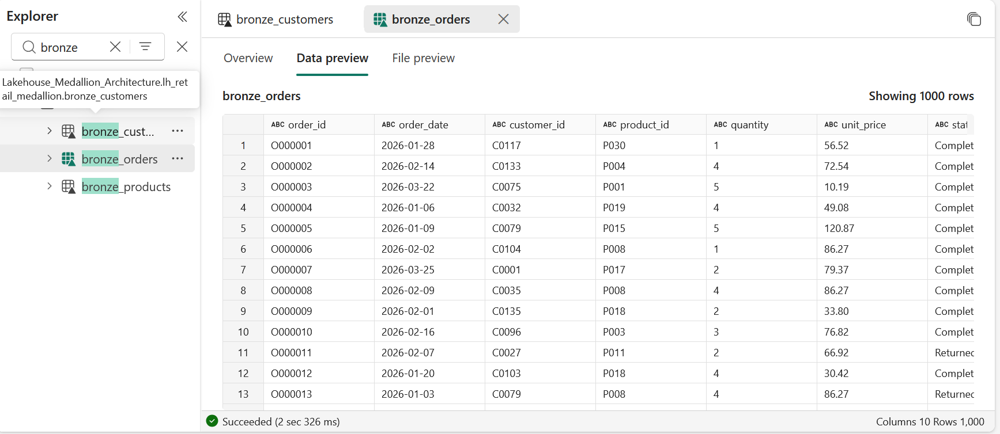
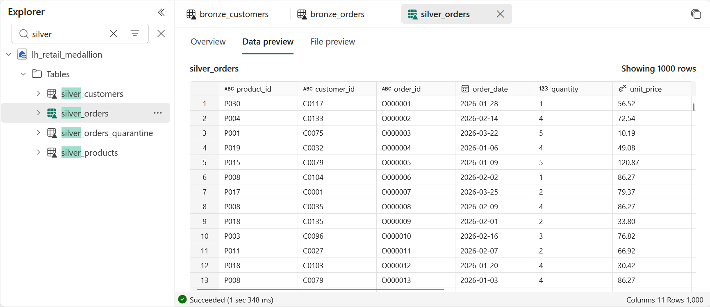
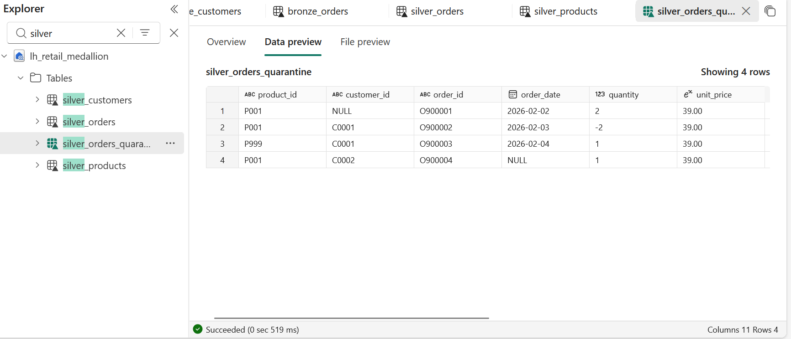
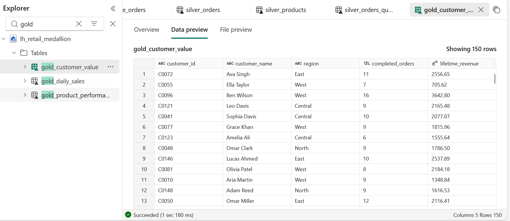
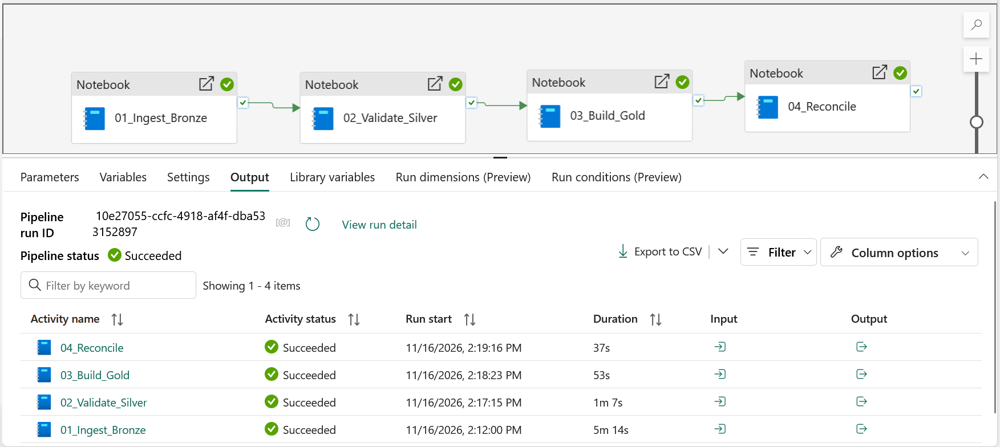
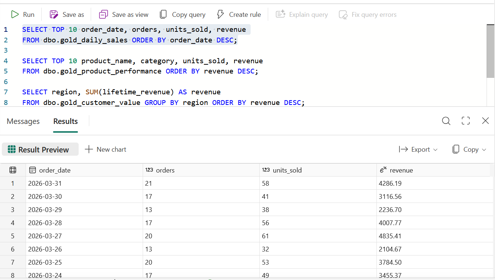
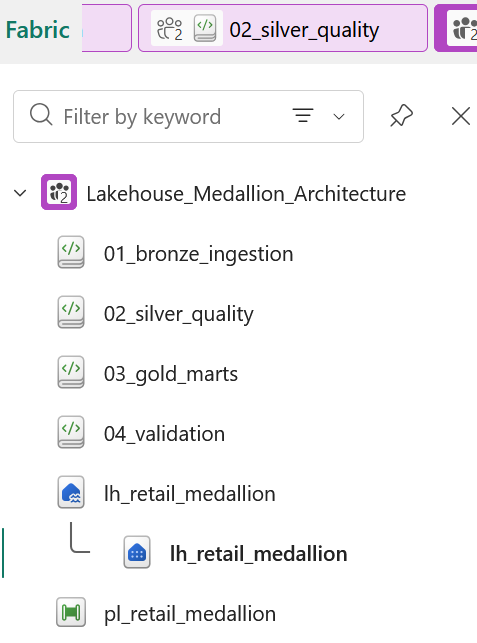

# Building a Retail Sales Lakehouse in Microsoft Fabric

**An end-to-end medallion pipeline with data-quality quarantine, reporting marts, and an orchestrated Fabric run.**

I built this project to work through a practical data-engineering question: *How do you turn imperfect retail exports into numbers that a business team can trust?* The starting point is a set of synthetic CSV extracts. The destination is a collection of Delta tables queryable through Fabric's SQL analytics endpoint.

Rather than dropping invalid rows without explanation, the pipeline keeps the rejected orders in a quarantine table, with a reason for each rejection. It also supports a second delivery containing new orders and a correction to an existing order.


> **Run evidence:** On **16 November 2026**, I captured a successful Fabric Data Pipeline execution with all four notebook activities marked *Succeeded*. The screenshots below are from that Fabric workspace, not UI mockups. The visible run proves the four-stage orchestration; it does **not** by itself prove that the optional second order batch was executed.

## The question I wanted the pipeline to answer

The sales team needs three straightforward views: daily sales, revenue by product, and revenue generated by each customer. Raw order exports make that harder than it seems. Values arrive as strings, some records reference missing customers or products, a date may be malformed, and orders can be completed, returned, or cancelled.

A useful lakehouse needs to do more than load CSV files. It should preserve incoming data, explain which records were excluded, apply consistent metrics, and make the output accessible to analysts without requiring them to understand Spark.

## From source exports to reporting tables

| Stage | Tables or files | Responsibility |
|---|---|---|
| **Source** | `customers.csv`, `products.csv`, `orders_batch_01.csv`, `orders_batch_02.csv` | Synthetic retail inputs with a later correction batch |
| **Bronze** | `bronze_customers`, `bronze_products`, `bronze_orders` | Store raw values and source-file / ingestion metadata |
| **Silver** | `silver_customers`, `silver_products`, `silver_orders`, `silver_orders_quarantine` | Parse types, deduplicate orders, validate keys and business rules |
| **Gold** | `gold_daily_sales`, `gold_product_performance`, `gold_customer_value` | Publish reporting-friendly Delta tables |
| **Consumption** | Lakehouse SQL analytics endpoint | Query the Gold tables in T-SQL |

The implementation uses four PySpark notebooks in one Lakehouse. The Fabric pipeline connects the notebooks with **On success** dependencies so that Gold isn't rebuilt if Silver fails, and reconciliation isn't reported as successful unless upstream activities finish.

### 1. Bronze: preserve what arrived

The ingestion notebook reads the source files from `Files/source/` and stores them in Delta tables. The order table also stores `_source_file` and `_ingested_at` to make a record's origin visible. A batch is skipped if its filename is already present in Bronze, preventing a simple same-file rerun from appending duplicate source data.



*Actual Fabric view of `bronze_orders`. The UI displays a **1,000-row preview limit**—this number is not the total record count.*

### 2. Silver: make rejected records explainable

The Silver notebook casts dates, timestamps, quantities, and prices to typed columns. It checks that orders have valid customer and product references, positive quantity and price, and an allowed status. When an order appears more than once, the newest `updated_at` version is retained.

Valid records go to `silver_orders`. Invalid records go to `silver_orders_quarantine` with `reject_reason`; no silently discarded invalid records in the latest deduplicated order set.



*Actual `silver_orders` preview. Dates and numeric fields now have typed schemas.*



*Actual quarantine view. The four first-batch failures correspond to a missing customer ID, negative quantity, unknown product ID and invalid date (the date parses to null). The rejection reasons are stored in the `reject_reason` column, off to the right of this screenshot.*

### 3. Gold: use a consistent definition of revenue

The Gold notebook counts **only `Completed` orders** as realized revenue. `Returned` and `Cancelled` orders remain available in Silver but do not contribute to these Gold revenue measures. Each valid completed order contributes `quantity × unit_price`.

Three Gold tables answer different business questions:

- `gold_daily_sales`: completed orders, units sold and revenue per order date.
- `gold_product_performance`: completed orders, units sold and revenue by product and category.
- `gold_customer_value`: completed-order count and lifetime completed-order revenue by customer and region.



*Actual `gold_customer_value` preview, showing 150 customer records.*

### 4. Orchestration: verify the entire path

I connected the notebooks in the order **Bronze → Silver → Gold → Reconciliation** and ran the pipeline in Microsoft Fabric. The captured run shows four successful activities and an overall pipeline status of **Succeeded**.



*Actual successful Fabric run on 16 November 2026. All four activities completed successfully.*

The project was run on a **Fabric Trial** workspace. Earlier attempts encountered an HTTP 430 capacity-limit error while provisioning Spark sessions; the successful pipeline screenshot documents the resolved execution outcome. That was a resource-allocation issue, not a failure in the transformation logic.

### 5. SQL: make the output easy to consume

Fabric automatically exposes registered Lakehouse Delta tables through its read-only SQL analytics endpoint. The included queries answer daily sales, highest-revenue products, customer revenue by region, and rejection counts by reason.



*Actual endpoint query result for `gold_daily_sales`, including date, completed-order count, units and revenue. Further queries are available in [`sql/reporting_queries.sql`](sql/reporting_queries.sql).*

## Results and checks

The original first-batch reconciliation notebook returned the following result in Fabric; it matches an independent replay of the supplied first-batch CSV files:

| Reconciliation metric | First batch |
|---|---:|
| Bronze order records | 1,604 |
| Distinct Bronze order IDs | 1,604 |
| Valid Silver orders | 1,600 |
| Quarantined orders | 4 |
| Completed-order Gold revenue | 319,205.28 |
| Reconciliation checks | `PASS` |

These are **first-batch results**. The pipeline screenshot establishes that orchestration succeeded, but the screenshot does not display its input `batch_id`. Therefore it should not be presented as independent evidence of a second-batch run.

For the **optional incremental scenario**, the supplied source files and the same stated rules yield the following independently calculated expectations. These have been checked locally, **not separately verified through a screenshot of a Fabric batch-02 run**:

| Reconciliation metric | Both batches (locally checked expectation) |
|---|---:|
| Bronze order rows | 2,006 |
| Distinct order IDs | 2,005 |
| Valid latest-version Silver orders | 2,000 |
| Quarantined latest-version orders | 5 |
| Completed-order revenue | 402,844.35 |

The difference between 2,006 Bronze records and 2,005 distinct IDs is intentional: the second batch includes **one corrected version of an existing order**, plus 400 new valid orders and one new invalid order. The Silver layer selects the latest version of the corrected order.

The repository includes a **standard-library local source-data test** so these source-level expectations can be checked without access to Fabric:

```bash
python tests/local_data_checks.py
```

This test verifies dataset dimensions, IDs, correction behavior, rejection counts and completed-order revenue. It **does not execute Spark or substitute for a successful Fabric pipeline run**.

## Repository guide

```text
fabric-retail-lakehouse/
├── README.md              # Project story, screenshots and how to reproduce it
├── assets/                # Architecture and genuine Fabric execution screenshots
├── data/                  # Four synthetic CSV files
├── notebooks/             # Four importable PySpark notebooks
├── sql/                   # Reporting and data-quality queries
└── tests/                 # Reproducible local checks for the sample files
```



*The Fabric workspace contains the four notebooks, `lh_retail_medallion`, its SQL analytics endpoint, and `pl_retail_medallion`.*

## Reproduce it in your own Fabric workspace

1. **Create a Lakehouse.** In a Fabric-enabled workspace, create a Lakehouse named `lh_retail_medallion`. These notebooks use the standard, unqualified Lakehouse table names; choose a compatible non-schema Lakehouse if prompted.
2. **Upload inputs.** Create `Files/source` in the Lakehouse and upload all four files from [`data/`](data/).
3. **Import and attach notebooks.** Import the `.ipynb` files in [`notebooks/`](notebooks/) and attach the same Lakehouse as the **default** for every notebook. Restart notebook Spark sessions after changing that default.
4. **Run the baseline.** Execute `01_bronze_ingestion` with `batch_id = "01"`, then run `02_silver_quality`, `03_gold_marts`, and `04_validation` in order. The first-batch reconciliation output should match the first table above.
5. **Create the Fabric pipeline.** Name it `pl_retail_medallion`. Add four Notebook activities, selecting notebooks 01 through 04 and connecting their **success** outputs. Use the same Lakehouse and compatible Spark configuration for each notebook.
6. **Run and inspect.** Trigger the pipeline and inspect the output details for all four activities. On constrained Trial capacity, close unused Spark sessions before retrying capacity-related HTTP 430 errors. If high-concurrency mode is available, compatible notebook activities can share a session when configured with the same session tag.
7. **Query the results.** Open the Lakehouse SQL analytics endpoint and run [`sql/reporting_queries.sql`](sql/reporting_queries.sql). Allow a short time for SQL metadata sync if a newly created table has not appeared yet.
8. **Optional: run batch 02.** Pass `batch_id = "02"` to notebook 01 through a Fabric parameter-cell / Notebook activity parameter override, then run notebooks 02–04. Inspect whether counts match the second table. Note that the Bronze notebook uses the source filename to skip previously loaded batches, so uploading replacement content under an already ingested filename is not an update mechanism.

### Practical implementation choices

| Choice | Why | Constraint |
|---|---|---|
| Delta tables for Bronze, Silver and Gold | Works with Spark and the SQL endpoint | Requires a Lakehouse with correctly attached default context |
| Append new source batches to Bronze | Preserves a simple arrival history | Filename-based idempotency is only suitable for immutable input files |
| Full-refresh Silver and Gold | Easy to inspect and reproduce for this data volume | Not designed for large production-scale recomputation |
| Latest `updated_at` per `order_id` | Handles a late source correction | Assumes the source timestamp is trustworthy |
| Explicit quarantine table | Makes rejected records auditable | One primary rejection reason is recorded per record |
| Completed-only revenue | Avoids mixing returned/cancelled orders into sales | Not a full accounting treatment of refunds and net revenue |
| Success-only pipeline dependencies | Prevents dependent notebook steps after an upstream failure | Resource limits can still block a run before code starts |

## What I would improve for production

The project deliberately keeps its scope small and reviewable. In a production environment, I would replace the filename-level ingestion check with a batch manifest or audit table, use Delta `MERGE` for incremental Silver upserts, add run-level observability and alerting, make revenue / returns semantics explicit with finance stakeholders, and define automated deployments. A Power BI semantic model on the Gold tables would be a useful next step.

**Scope and provenance:** All customer, product and order data in this repository are **synthetic**. The screenshots are from a real Fabric Trial workspace execution on 16 November 2026. No customer production data, credentials or tenant identifiers are needed to reproduce the example. The source data and local checks are reproducible; a reader will need their own Fabric workspace to execute the notebooks and pipeline.

## Microsoft documentation

- [Fabric Runtime 2.0](https://learn.microsoft.com/en-us/fabric/data-engineering/runtime-2-0)
- [Notebook activity in a Fabric Data Pipeline](https://learn.microsoft.com/en-us/fabric/data-factory/notebook-activity)
- [Fabric Lakehouse SQL analytics endpoint](https://learn.microsoft.com/en-us/fabric/data-engineering/lakehouse-sql-analytics-endpoint)
- [High concurrency for notebook activities](https://learn.microsoft.com/en-us/fabric/data-engineering/configure-high-concurrency-session-notebooks-in-pipelines)
